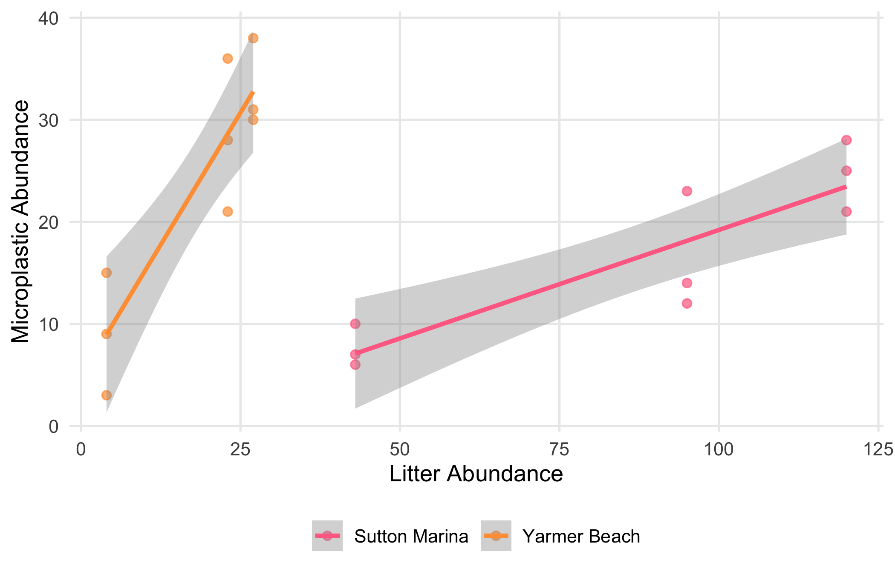

# Micro- and macroplastic pollution on a protected vs an urban beach in Southwest England

Field and laboratory project comparing plastic pollution at **Yarmer Beach** (Thurlestone; a protected, rural beach) and **Sutton Harbour Marina** (an urban beach in the port of Plymouth). Microplastics were quantified in water and sediment samples. Macro-litter was recorded along shoreline transects, and its relationship with microplastic abundance was tested.

*Imperial College London / University of Plymouth field course, June 2025. Group project; analysis and report by Markéta Šimková.*

📄 **Report:** [`report/Simkova_2025_plymouth_microplastics.pdf`](report/Simkova_2025_plymouth_microplastics.pdf)



## Questions
1. Do micro- and macroplastic levels differ between a protected coastal beach and an urban port beach?
2. Is macro-litter abundance associated with microplastic abundance in shoreline sediment?

## Methods
- **Sampling (6–7 June 2025, low tide):** at each site, three strandlines (low strand, high strand, vegetation line) were sampled at 0, 25 and 50 m. That gave **24 samples: 18 sediment and 6 water**. Macro-litter within 1 m of each transect was counted (6 transects).
- **Laboratory:** water was settled, subsampled (600 ml) and vacuum-filtered (11 µm). Sediment microplastics were separated by density flotation in 35 ppt seawater (50 g sediment). Particles were counted under a dissection microscope (Leica EZ4, 8–35×).
- **Inter-observer reliability:** two observers counted 13 filters. Two-way, single-measure ICC; counts were averaged because agreement was low.
- **Statistics:** Kruskal–Wallis site comparisons, Spearman correlation, and a multiple linear regression `microplastic ~ site + litter` for sediment samples.

## Key results
| | Sutton Harbour Marina | Yarmer Beach | Test |
|---|---|---|---|
| Water microplastics, median (IQR) | 32.5 (11.3) | 15.8 (4.0) | χ² = 3.86, p = 0.050 |
| Sediment microplastics, median (IQR) | 14.0 (13.0) | 28.0 (16.0) | χ² = 2.13, p = 0.145 |
| Macro-litter, median (IQR) | 95.0 (77.0) | 23.0 (23.0) | χ² = 13.11, p < 0.001 |

- Litter and sediment microplastics were **not correlated on their own** (Spearman ρ = 0.07, p = 0.78).
- **Site and litter together** predicted sediment microplastics:
  - Yarmer Beach: +26.7 particles relative to Sutton Harbour Marina (p < 0.001).
  - Litter: +0.29 particles per litter item (p = 0.002).
  - R² = 0.54, adjusted R² = 0.48; residuals normal (Shapiro–Wilk p = 0.66).
- Inter-observer ICC = 0.35 (consistency) and 0.36 (agreement).

**Limitations:**
- Only two sites, with three transects and three water samples per site.
- Litter is recorded per transect, so it is repeated across the three sediment samples on each transect.
- Particles were identified visually, without polymer confirmation (e.g. FTIR).

## Reproducing the analysis
Tested with R 4.6.2; package versions are pinned in `renv.lock`. From the repository root:

```r
install.packages("renv")
renv::restore()        # installs the pinned package versions from renv.lock
source("run_all.R")    # or, from a shell: Rscript run_all.R
```

`run_all.R` rebuilds everything in `data/processed/` and `outputs/` from `data/raw/` in a few seconds.

The figures in `outputs/figures/` reproduce Figures 3 and 4 of the report.

## Repository structure
```
├── run_all.R                     # runs the full pipeline
├── R/
│   ├── 00_setup.R                # packages, paths, plot theme
│   ├── 01_clean_merge.R          # clean sample sheet, join litter, convert coordinates
│   ├── 02_interobserver.R        # ICC between observers
│   ├── 03_descriptives_tests.R   # medians/IQR, Kruskal–Wallis, Spearman
│   ├── 04_regression.R           # multiple linear regression + diagnostics
│   └── 05_figures.R              # report figures
├── data/
│   ├── raw/                      # field and laboratory data as recorded (see data/README.md)
│   └── processed/                # cleaned, merged table (generated)
├── outputs/
│   ├── figures/                  # fig3, fig4, figS1 (generated)
│   └── tables/                   # result tables as CSV (generated)
└── report/                       # submitted report (PDF)
```

## Licence
- **Code:** MIT ([LICENSE](LICENSE)).
- **Data in `data/`:** [CC BY 4.0](https://creativecommons.org/licenses/by/4.0/).

## Citation
Šimková, M. (2025). *Comparative analysis of microplastic and macroplastic pollution on a protected coastal beach and an urban port beach in Southwest England.* Imperial College London / University of Plymouth. See [`CITATION.cff`](CITATION.cff).
